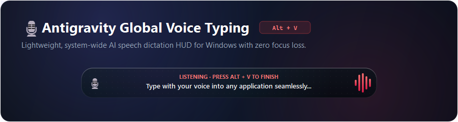
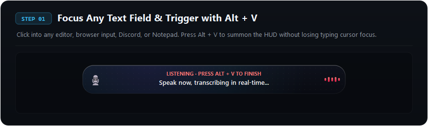
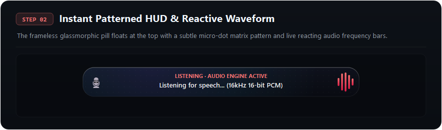
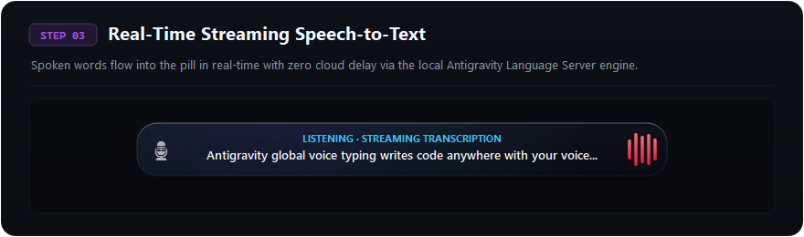
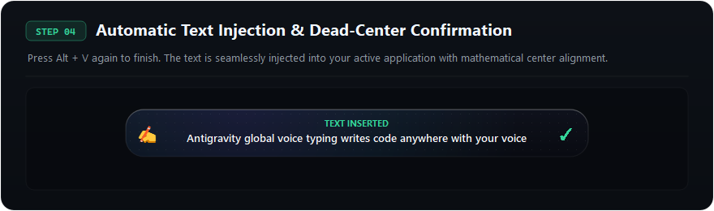

<p align="center">
  
</p>

<p align="center">
  <b>A lightweight, system-wide AI voice dictation HUD utility for Windows.</b><br>
  Dictate text with your voice anywhere on your computer using a global hotkey (<code>Alt + V</code> or <code>Ctrl + Shift + V</code>).
</p>

<p align="center">
  
  
  
  
</p>

---

Whether you are writing code in **VS Code**, taking notes in **Obsidian**, drafting emails in **Chrome**, chatting in **Discord**, or typing in **Word** and **Notepad**, simply press the hotkey, speak naturally, and your speech is converted to text and automatically pasted directly at your active cursor.

---

## 🎯 The Motivation: Why Build This?

Most speech-to-text and voice typing tools on Windows—including native solutions like `Win + H` and various third-party apps—often fall short. They frequently struggle with technical jargon, fumble punctuation, suffer from noticeable latency, or introduce clunky popups that interrupt your workflow.

**Google Antigravity's speech-to-text engine, by contrast, is extraordinarily good.** It delivers blazing-fast streaming transcription, handles natural conversational pacing with high accuracy, and effortlessly understands technical terminology and code syntax without stuttering.

**The Vision:** Why should such a superior voice recognition engine be confined solely to an IDE prompt box?

This project liberates Antigravity's voice engine and makes it a universal superpower across the entire Windows operating system. With a single global shortcut (`Alt + V`), you get the speed and precision of Antigravity's transcription anywhere you can type.

---

## 🚀 How It Works (Step-by-Step)

### **Step 1: Focus Any Text Field & Press `Alt + V`**
Click into any text field across Windows (Notepad, VS Code, Discord, Browser, Terminal, etc.). Press **`Alt + V`** to summon the floating HUD pill. The application captures your active foreground window without stealing input focus.

<p align="center">
  
</p>

---

### **Step 2: Instant Patterned HUD & Reactive Waveform**
The frameless glassmorphic HUD pill floats at the top of your screen. It features a subtle micro-dot matrix pattern, cyan/indigo ambient mesh glow, and dynamic audio visualizer bars that react in real-time to your microphone volume.

<p align="center">
  
</p>

---

### **Step 3: Real-Time Streaming Speech-to-Text**
Speak naturally. When connected to the local Antigravity Language Server engine, words stream in real-time with zero cloud latency. If Antigravity is not active, the universal fallback engine handles recognition seamlessly.

<p align="center">
  
</p>

---

### **Step 4: Automatic Text Injection & Dead-Center Confirmation**
Press **`Alt + V`** again (or pause) to complete dictation. The HUD displays a centered emerald **`✓ TEXT INSERTED`** badge, and the transcribed text is automatically pasted at your cursor position with zero focus loss.

<p align="center">
  
</p>

---

## ✨ Key Features

- 🌍 **Universal Dictation Anywhere**: Works across all Windows applications. If you can click and type there, you can dictate there.
- ⚡ **Dual Intelligence Engine (Hybrid Architecture)**:
  - **Antigravity Engine**: Directly communicates with the local Antigravity Language Server engine for ultra-fast, accurate real-time speech transcription with zero cloud latency.
  - **Universal Fallback Engine**: Seamlessly falls back to universal speech recognition (Google Web Speech API) when Antigravity is offline or on machines without Antigravity installed.
- 💎 **Patterned Glassmorphic Floating HUD**:
  - A modern, frameless floating pill overlay at the top of your screen with micro-dot grid texturing and ambient glowing mesh styling.
  - Symmetrical 3-column layout guaranteeing 100% dead-center alignment for status cues and transcribed text.
  - Live animated waveform visualizer reacting in real time to your voice volume.
- 🎯 **Zero Focus Loss**:
  - Configured with `Qt.WindowDoesNotAcceptFocus` and native Win32 window management.
  - The floating overlay never steals focus from your active text field, keeping your typing cursor right where you left it.
- 🎹 **Multi-Tier Global Hotkey System**:
  - Global `Alt + V` (and alternate `Ctrl + Shift + V`) powered by native Win32 `RegisterHotKey` with low-level keyboard hook fallbacks.
  - Audio chimes provide subtle auditory confirmation when dictation starts and when text is inserted.
- 🖥️ **System Tray Integration**:
  - Lives quietly in your Windows system tray.
  - Displays engine connection status and enables one-click voice typing toggling directly from the tray icon.

---

## 📦 Installation & Setup

### Prerequisites
- Windows 10 or Windows 11 (64-bit)
- Python 3.10+ installed

### 1. Clone the Repository
```bash
git clone https://github.com/kutuphanekitabi11-web/Antigravity-Voice-Typing.git
cd Antigravity-Voice-Typing
```

### 2. Install Dependencies
```bash
pip install -r requirements.txt
```

*Required packages: `sounddevice`, `numpy`, `PyQt5`, `psutil`, `pywin32`, `SpeechRecognition`, `keyboard`, `pynput`.*

---

## 🏃 Launching the Application

- **Background Silent Mode**: Double-click `baslat.bat`. The app starts silently with a tray icon in your taskbar.
- **Console / Debug Mode**: Double-click `baslat_debug.bat` to see live engine logs and recognition diagnostics in a terminal.

### Start Automatically with Windows (Optional)
1. Press `Win + R`, type `shell:startup`, and press `Enter`.
2. Right-click `baslat.bat` inside the project folder, select **Create shortcut**, and paste the shortcut into the Startup folder.
3. Antigravity Voice Typing will now be ready in the background whenever your PC boots up.

---

## ⌨️ Keyboard Shortcuts

| Shortcut | Action |
| --- | --- |
| `Alt + V` | Primary toggle: Start recording / Stop recording & paste |
| `Ctrl + Shift + V` | Secondary hotkey alternative |
| Left-Click Tray Icon | Start / Stop dictation toggle |

---

## 🏗️ Project Architecture

```
Antigravity-Voice-Typing/
├── assets/                # Step-by-step UI showcase screenshots & hero banners
├── app.py                 # Core application controller & system tray management
├── overlay_widget.py      # Patterned glassmorphic HUD pill with audio visualizer
├── antigravity_bridge.py  # Local streaming speech engine client (ConnectRPC)
├── fallback_engine.py     # Universal speech recognition engine
├── audio_engine.py        # 16kHz 16-bit Mono PCM audio capture & RMS level analyzer
├── injector.py            # Win32 foreground window preservation & text injection
├── hotkey_service.py      # Global hotkey listeners (RegisterHotKey + keyboard hooks)
├── baslat.bat             # Silent background Windows launcher
├── requirements.txt       # Python dependencies
└── README.md              # Documentation
```

---

## 📄 License

MIT License. Free and open source for everyone.
